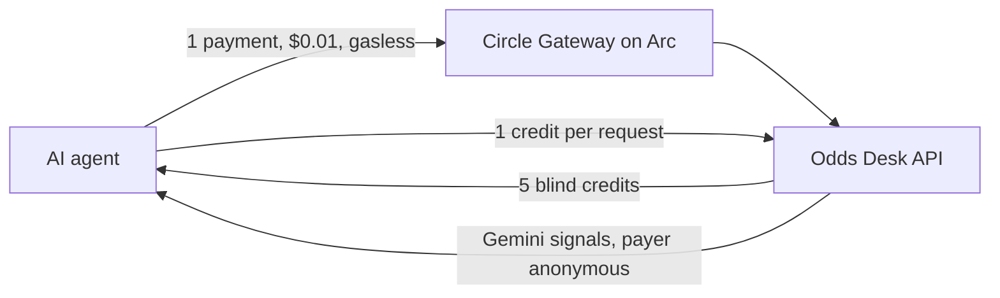
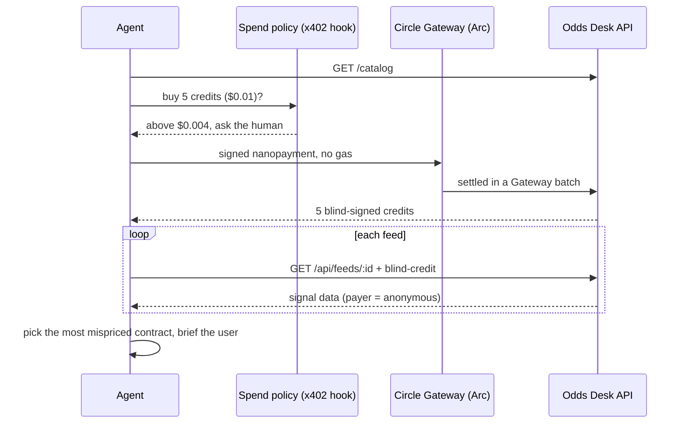

# Blindspot

**Private pay-per-request for AI agents, on Arc.** Our demo agent, Odds Desk, buys Gemini prediction-market signals for fractions of a cent, and the seller never learns who bought what.

- **Track:** Agentic Payments and AI · **Chain award:** Arc · **Bounty:** Gemini Prediction Markets
- **Slides:** [`demo/slides/blindspot.pdf`](demo/slides/blindspot.pdf)

## The problem

AI agents now pay for APIs one request at a time with x402. Every one of those payments is public: who paid, which feed, how much, when. For a trading agent, that history is its strategy, and anyone watching the wallet can copy it or trade ahead of it.

## Our solution

The agent buys a pack of credits once, with a gasless **Circle Gateway** nanopayment on **Arc**. Each later request is paid with one credit through **`blind-credit`**, a new x402 payment scheme we built. The seller can check that a credit is valid and unspent, but cannot link it to the wallet that bought it.



| | Plain x402 | Blindspot |
|---|---|---|
| Seller learns | wallet, feed, time | a valid credit |
| Visible per request | a payment | nothing |
| Price reveals the feed | yes | no, 1 credit buys any feed |
| Gas per request | depends on settlement | none |

## How a run works



**Agent decision loop.** Discover the paid feeds, plan which to buy, pass every payment through the spend policy, buy one credit pack, pay each feed with a credit, then pick the contract where its volatility model disagrees most with the Gemini order book.

**Guardrails** (run inside the x402 `onBeforePaymentCreation` hook, so a refused payment is never signed):

| Rule | Value |
|---|---|
| Origin allowlist | Odds Desk only |
| Per call | $0.01 max |
| Per session | $0.05 max |
| Human approval | above $0.004 |

## Does the signal pay for itself?

On the 736 Gemini crypto contracts that settled in the 24 hours before submission, our model scores a Brier of **0.112** an hour before expiry, against **0.152** for reading the spot price. Reproduce with `bun backtest/calibration.ts`.

## Market

- **Today:** 254M agent payments and $80.2M settled over x402 since March 2025 ([Paymentscan](https://paymentscan.xyz/agentic)); 138M+ x402 transactions by October 2026 ([CoinDesk](https://www.coindesk.com/business/2026/10/14/ai-agents-make-138-million-crypto-payments-as-u-s-dominates-spending-on-ai-models)).
- **2030 scenario:** agents could orchestrate **$3T to $5T** of commerce globally (McKinsey, via [Inside Deep Tech](https://www.insidedeeptech.com/agentic-payments-ai-agent-payment-ecosystem-full-guide/)).
- **Our wedge:** every one of those payments is public by default. Agents that trade, research or negotiate need private payments first, and data sellers want their business.
- **Business model:** data sellers plug `blind-credit` into their x402 server and pay a small fee per redeemed credit to the mint; agents pay the same price as today.

## Built with

| Piece | Use |
|---|---|
| Circle Gateway nanopayments, `@circle-fin/x402-batching` 4.0 | gasless USDC payments on Arc, batched settlement |
| x402 v2: `@x402/core`, `@x402/hono`, `@x402/fetch` 2.31 | seller with two payment schemes, client with spend controls |
| Arc testnet, USDC as gas | one asset, prices in cents |
| Gemini Prediction Markets API | live odds, settled outcomes, settlement-index candles |
| `blind-credit` (ours) | private per-request payments, spec in [`specs/scheme_blind_credit.md`](specs/scheme_blind_credit.md) |

**Arc addresses (testnet, `eip155:5042002`)**

| Item | Address |
|---|---|
| USDC | `0x3600000000000000000000000000000000000000` |
| Circle Gateway Wallet | `0x0077777d7EBA4688BDeF3E311b846F25870A19B9` |
| Agent | `0xa3dAa7D967629cc4a4B99c3Cc12fB3C2d7D20e05` |
| Seller | `0xc1232D14AE5f79922a5B7b4384023fAA89B074Fa` |

Gateway deposit: [0xf02658cd…](https://testnet.arcscan.app/tx/0xf02658cd5718fe230e468e9f7bcd179359f2cdec8efeee678f67b1fc5d024d22)

## Moving forward

1. Propose `blind-credit` as an official x402 scheme.
2. Partner with Circle so credit packs are bought straight from a Gateway balance.
3. Open the mint to any x402 data seller, starting with prediction-market and trading data.
4. Let the agent place Gemini orders behind the same approval policy.

## Run it

```bash
bun install
cp .env.example .env        # AGENT_PRIVATE_KEY, MERCHANT_ADDRESS
bun run start               # http://localhost:4021
bun test
```

Fund the agent with Arc testnet USDC at [faucet.circle.com](https://faucet.circle.com).

## Repo

| Path | What |
|---|---|
| `src/credits/` | `blind-credit` x402 scheme: client, server, facilitator, mint |
| `src/paywall.ts` | x402 server with Circle Gateway and `blind-credit` |
| `src/agent/` | agent loop, Gateway payer, spend policy, credit wallet |
| `src/signals.ts`, `src/gemini.ts` | Gemini data and pricing model |
| `public/` | live dashboard |
| `backtest/` | signal backtest and credit benchmark |
| `demo/slides/` | pitch deck (LaTeX) and talk script |
